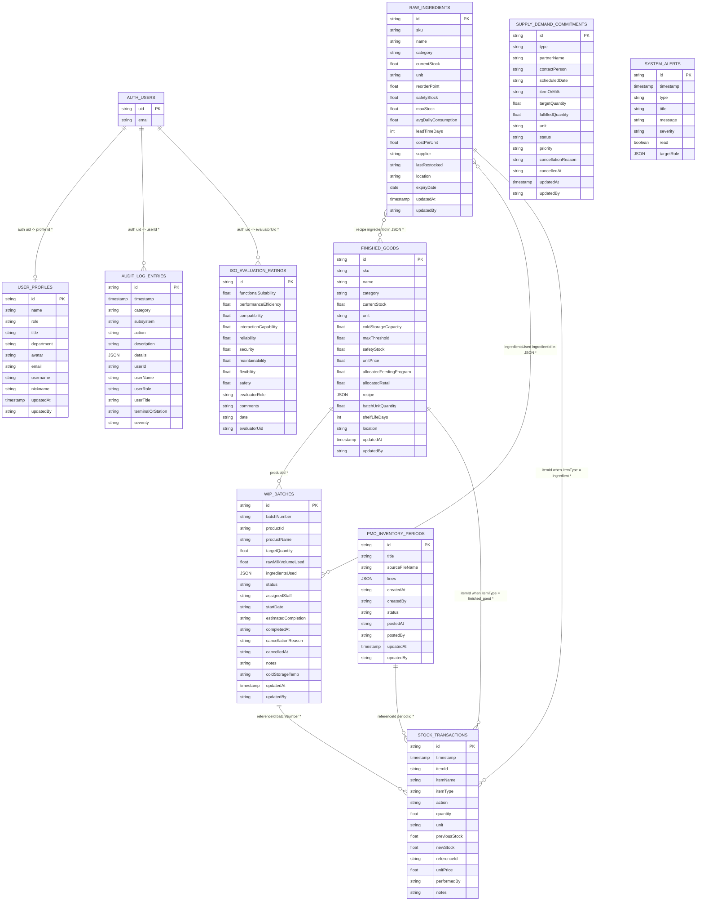
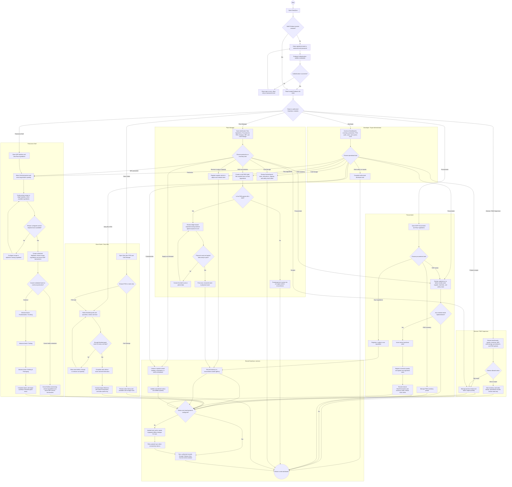

# DairySync ER and Activity Diagrams

These diagrams describe DairySync, not the separate “Local Bites” system depicted in the supplied activity-diagram PDFs. The PDFs are used as references for swimlanes, decision points, and role-based flows. Entity names and workflows below are based on DairySync's Data Connect schema and application behavior.

## Entity-Relationship Diagram

DairySync | Core directory ERD
Firestore/Data Connect logical model - exact field names, document keys, and application references

This version follows the same ERD structure used in the Local Bites PDF reference: each entity is listed with its logical key, key type, and important application references. The DairySync model uses Firebase Auth + Data Connect tables instead of Firestore collections, but the organization of PK, REF, and logical relationships follows the same pattern.

Auth + identity
- AUTH_USERS [reference]
  - users/{uid}
  - PK, REF
  - {uid} string
  - Current Firebase Authentication user identity

- USER_PROFILES
  - user_profiles/{id}
  - PK
  - {id} string
  - REF: auth uid or identifier
  - name, role, title, department, avatar, email, username, nickname, updatedAt, updatedBy

Inventory and production
- RAW_INGREDIENTS
  - raw_ingredients/{id}
  - PK
  - {id} string
  - REF: supplier, location
  - sku, name, category, currentStock, unit, reorderPoint, safetyStock, maxStock, avgDailyConsumption, leadTimeDays, costPerUnit, supplier, lastRestocked, location, expiryDate, updatedAt, updatedBy

- FINISHED_GOODS
  - finished_goods/{id}
  - PK
  - {id} string
  - REF: product recipe is embedded in JSON; WIP batches reference productId
  - sku, name, category, currentStock, unit, coldStorageCapacity, maxThreshold, safetyStock, unitPrice, allocatedFeedingProgram, allocatedRetail, recipe, batchUnitQuantity, shelfLifeDays, location, updatedAt, updatedBy

- WIP_BATCHES
  - wip_batches/{id}
  - PK
  - {id} string
  - REF: productId -> finished_goods.id
  - batchNumber, productId, productName, targetQuantity, rawMilkVolumeUsed, ingredientsUsed, status, assignedStaff, startDate, estimatedCompletion, completedAt, cancellationReason, cancelledAt, notes, coldStorageTemp, updatedAt, updatedBy

- SUPPLY_DEMAND_COMMITMENTS
  - supply_demand_commitments/{id}
  - PK
  - {id} string
  - REF: itemOrMilk may correspond to product or raw material reference
  - type, partnerName, contactPerson, scheduledDate, itemOrMilk, targetQuantity, fulfilledQuantity, unit, status, priority, cancellationReason, cancelledAt, updatedAt, updatedBy

- SYSTEM_ALERTS
  - system_alerts/{id}
  - PK
  - {id} string
  - type, timestamp, title, message, severity, read, targetRole

Transaction and audit layer
- STOCK_TRANSACTIONS
  - stock_transactions/{id}
  - PK
  - {id} string
  - REF: itemId, referenceId, performedBy
  - timestamp, itemId, itemName, itemType, action, quantity, unit, previousStock, newStock, referenceId, unitPrice, notes

- PMO_INVENTORY_PERIODS
  - pmo_inventory_periods/{id}
  - PK
  - {id} string
  - REF: linked material identifiers inside JSON lines
  - title, sourceFileName, lines, createdAt, createdBy, status, postedAt, postedBy, updatedAt, updatedBy

- ISO_EVALUATION_RATINGS
  - iso_evaluation_ratings/{id}
  - PK
  - {id} string
  - REF: evaluatorUid -> auth uid
  - functionalSuitability, performanceEfficiency, compatibility, interactionCapability, reliability, security, maintainability, flexibility, safety, evaluatorRole, comments, date, evaluatorUid

- AUDIT_LOG_ENTRIES
  - audit_log_entries/{id}
  - PK
  - {id} string
  - REF: userId -> auth uid; item references inside details JSON
  - timestamp, category, subsystem, action, description, details, userId, userName, userRole, userTitle, terminalOrStation, severity

Logical ER diagram

Notes
- `AUTH_USERS` is part of Firebase Authentication and is not a Data Connect table; it is included as the external identity reference.
- `STOCK_TRANSACTIONS.itemId` and `referenceId` are logical application references, not enforced database foreign keys.
- `recipe`, `ingredientsUsed`, and `lines` are embedded JSON payloads rather than child tables.

## Activity Diagram

This diagram follows DairySync's staff login, role-specific navigation, and the actual operational flows for procurement, raw ingredients, PMO reconciliation, WIP production, cold storage, commitments, and Dairy Box POS. Role lanes reflect the access documented in the system guide; Director access is read-only except for recipe management.

WIP cancellation restores materials only while a batch is still scheduled. PMO posting is one-time and locked afterward. Raw ingredient and finished-good transaction references are logical links as described in the ER diagram. Local caching and the offline queue are implementation details, not additional Data Connect entities.
