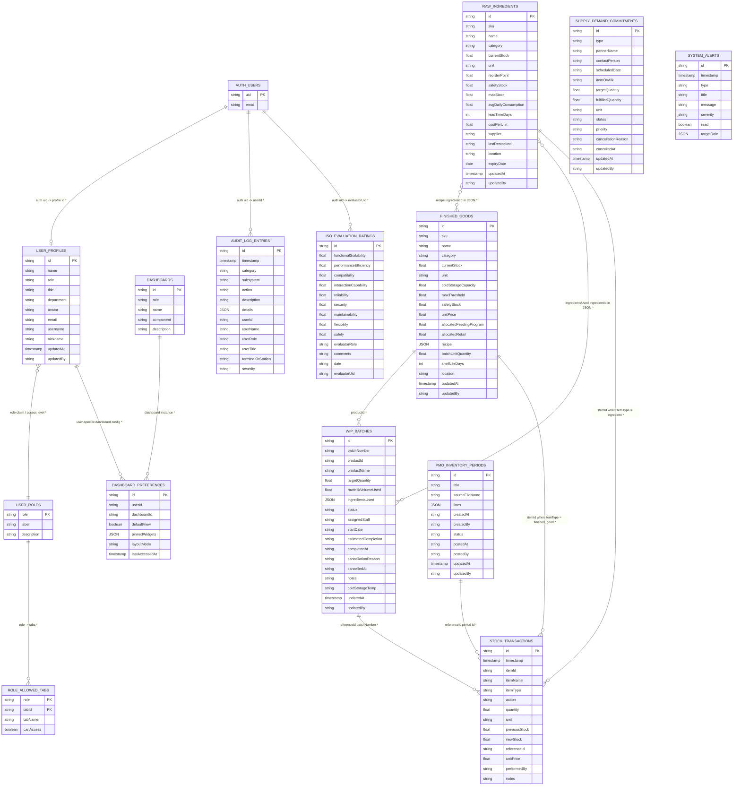
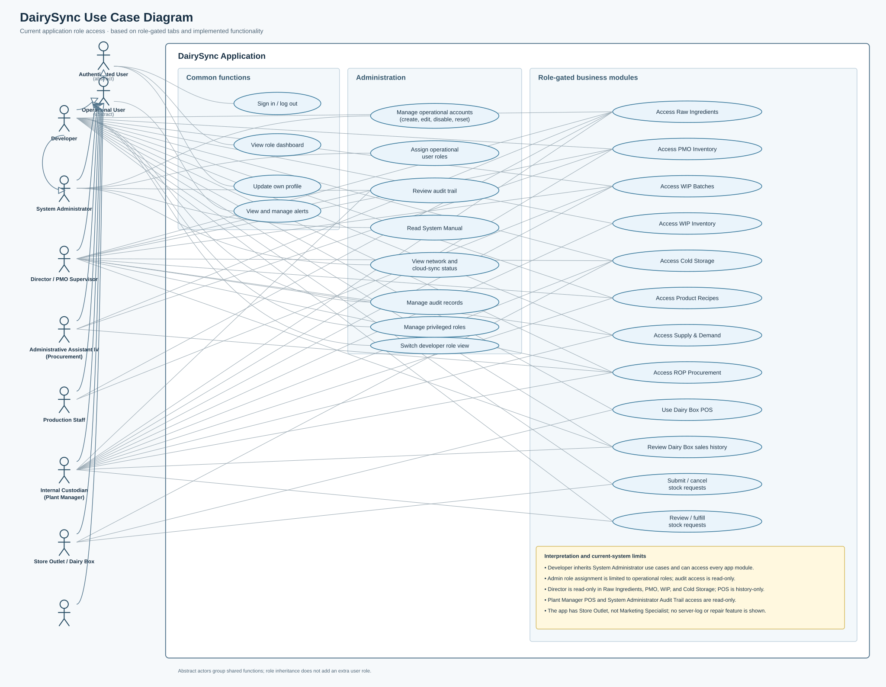

# DairySync ER and Activity Diagrams

For a guided, presentation-style walkthrough of the five activity flows, see [DairySync Activity Flow Presentation](./DairySync-Activity-Presentation.html). Use its slide controls or print it to PDF.

These diagrams describe DairySync, not the separate “Local Bites” system depicted in the supplied activity-diagram PDFs. The PDFs are used as references for swimlanes, decision points, and role-based flows. Entity names and workflows below are based on DairySync's Data Connect schema and application behavior.

## Entity-Relationship Diagram

DairySync | Core directory ERD
Firestore/Data Connect logical model - exact field names, document keys, and application references

This version follows the same ERD structure used in the Local Bites PDF reference: each entity is listed with its logical key, key type, and important application references. The DairySync model uses Firebase Auth + Data Connect tables instead of Firestore collections, but the organization of PK, REF, and logical relationships follows the same pattern.

Auth + identity
- AUTH_USERS [reference]
  - users/{uid}
  - PK, REF
  - {uid} string
  - Current Firebase Authentication user identity

- USER_PROFILES
  - user_profiles/{id}
  - PK
  - {id} string
  - REF: auth uid or identifier
  - name, role, title, department, avatar, email, username, nickname, updatedAt, updatedBy

- USER_ROLES
  - logical enum / authorization set
  - developer, director, procurement, plant_manager, production_staff, store_outlet
  - Used as role claim and permission gate for dashboard access

- ROLE_ALLOWED_TABS
  - Application-level access matrix
  - role -> list of enabled tabs/modules
  - Example: dashboard, ingredients, wip, finished, procurement, pos, audit, documentation
  - Not a strict database table in the current Data Connect schema, but a conceptual access model used by the app

- DASHBOARDS
  - Dashboard entry points keyed by role and subsystem
  - DeveloperDashboard, DirectorDashboard, ProcurementDashboard, PlantManagerDashboard, ProductionStaffDashboard, StoreOutletDashboard
  - Component-level UI representation, not a relational child table in the DB

- DASHBOARD_PREFERENCES
  - userId, dashboardId, defaultView, pinnedWidgets, layoutMode, lastAccessedAt
  - Optional user personalization data; represents role-based dashboard behavior

Inventory and production
- RAW_INGREDIENTS
  - raw_ingredients/{id}
  - PK
  - {id} string
  - REF: supplier, location
  - sku, name, category, currentStock, unit, reorderPoint, safetyStock, maxStock, avgDailyConsumption, leadTimeDays, costPerUnit, supplier, lastRestocked, location, expiryDate, updatedAt, updatedBy

- FINISHED_GOODS
  - finished_goods/{id}
  - PK
  - {id} string
  - REF: product recipe is embedded in JSON; WIP batches reference productId
  - sku, name, category, currentStock, unit, coldStorageCapacity, maxThreshold, safetyStock, unitPrice, allocatedFeedingProgram, allocatedRetail, recipe, batchUnitQuantity, shelfLifeDays, location, updatedAt, updatedBy

- WIP_BATCHES
  - wip_batches/{id}
  - PK
  - {id} string
  - REF: productId -> finished_goods.id
  - batchNumber, productId, productName, targetQuantity, rawMilkVolumeUsed, ingredientsUsed, status, assignedStaff, startDate, estimatedCompletion, completedAt, cancellationReason, cancelledAt, notes, coldStorageTemp, updatedAt, updatedBy

- SUPPLY_DEMAND_COMMITMENTS
  - supply_demand_commitments/{id}
  - PK
  - {id} string
  - REF: itemOrMilk may correspond to product or raw material reference
  - type, partnerName, contactPerson, scheduledDate, itemOrMilk, targetQuantity, fulfilledQuantity, unit, status, priority, cancellationReason, cancelledAt, updatedAt, updatedBy

- SYSTEM_ALERTS
  - system_alerts/{id}
  - PK
  - {id} string
  - type, timestamp, title, message, severity, read, targetRole

Transaction and audit layer
- STOCK_TRANSACTIONS
  - stock_transactions/{id}
  - PK
  - {id} string
  - REF: itemId, referenceId, performedBy
  - timestamp, itemId, itemName, itemType, action, quantity, unit, previousStock, newStock, referenceId, unitPrice, notes

- PMO_INVENTORY_PERIODS
  - pmo_inventory_periods/{id}
  - PK
  - {id} string
  - REF: linked material identifiers inside JSON lines
  - title, sourceFileName, lines, createdAt, createdBy, status, postedAt, postedBy, updatedAt, updatedBy

- ISO_EVALUATION_RATINGS
  - iso_evaluation_ratings/{id}
  - PK
  - {id} string
  - REF: evaluatorUid -> auth uid
  - functionalSuitability, performanceEfficiency, compatibility, interactionCapability, reliability, security, maintainability, flexibility, safety, evaluatorRole, comments, date, evaluatorUid

- AUDIT_LOG_ENTRIES
  - audit_log_entries/{id}
  - PK
  - {id} string
  - REF: userId -> auth uid; item references inside details JSON
  - timestamp, category, subsystem, action, description, details, userId, userName, userRole, userTitle, terminalOrStation, severity

Logical ER diagram

Notes
- `AUTH_USERS` is part of Firebase Authentication and is not a Data Connect table; it is included as the external identity reference.
- `USER_ROLES` and `ROLE_ALLOWED_TABS` represent the app's role-based access model and dashboard permissions (`developer`, `director`, `procurement`, `plant_manager`, `production_staff`, `store_outlet`).
- `DASHBOARDS` and `DASHBOARD_PREFERENCES` capture the role-specific dashboard behavior in the front-end, even though they are conceptual UI/configuration entities rather than fully normalized database tables.
- `STOCK_TRANSACTIONS.itemId` and `referenceId` are logical application references, not enforced database foreign keys.
- `recipe`, `ingredientsUsed`, and `lines` are embedded JSON payloads rather than child tables.

## Activity Diagram

This diagram shows the full DairySync operating flow for all application modules: secure login, role-based landing, dashboard navigation, module interaction, system alerts, reports, ISO evaluation, and data synchronization. It covers the actual screens and permissions defined by the app’s tab model and role matrix.

```mermaid
flowchart TD
    start((Start)) --> appOpen["Open DairySync app"]
    appOpen --> authState{"Authentication state ready?"}
    authState -- No --> loading["Check Firebase session and role claims"]
    loading --> authReady{"Session valid?"}
    authReady -- No --> login["Display login screen"]
    login --> credentials["Enter email/username and password"]
    credentials --> firebaseAuth["Firebase Authentication validates credentials"]
    firebaseAuth --> authSuccess{"Authentication successful?"}
    authSuccess -- No --> loginError["Show error; allow retry or password reset"]
    loginError --> login
    authSuccess -- Yes --> profileLoad["Load user profile, role, and allowed tabs"]
    authReady -- Yes --> profileLoad
    profileLoad --> roleRoute{"Route to authorized dashboard"}

    subgraph secure["Security and access control"]
        accessCheck{"Current tab allowed for current role?"}
        accessDenied["Show Access Restricted screen"]
        homeRedirect["Return to Command Center"]
    end

    roleRoute --> dashboard["Go to Command Center Dashboard"]
    dashboard --> moduleChoice{"Choose module or report"}
    moduleChoice --> accessCheck
    accessCheck -- No --> accessDenied --> homeRedirect --> dashboard
    accessCheck -- Yes --> mainMenu["User selects app module"]

    subgraph rolehub["Role-based navigation hub"]
        dashboardFlow["Dashboard / Command Center"]
        ingredientsFlow["Raw Ingredients"]
        pmoFlow["PMO Inventory"]
        wipFlow["WIP Batches"]
        finishedFlow["Cold Storage"]
        recipesFlow["Product Recipes"]
        syncFlow["Supply & Demand"]
        procurementFlow["ROP Procurement"]
        posFlow["Dairy Box POS / Sales History"]
        auditFlow["Audit Trail"]
        docsFlow["System Manual / Documentation"]
        isoFlow["ISO 25010 Evaluation"]
        reportsFlow["Reports / Analytics"]
        logoutFlow["Logout / Role switch"]
    end

    mainMenu --> dashboardFlow
    mainMenu --> ingredientsFlow
    mainMenu --> pmoFlow
    mainMenu --> wipFlow
    mainMenu --> finishedFlow
    mainMenu --> recipesFlow
    mainMenu --> syncFlow
    mainMenu --> procurementFlow
    mainMenu --> posFlow
    mainMenu --> auditFlow
    mainMenu --> docsFlow
    mainMenu --> isoFlow
    mainMenu --> reportsFlow
    mainMenu --> logoutFlow

    dashboardFlow --> roleSummary["View role-specific KPI cards and operational summary"]
    roleSummary --> dashboardAction{"Open a subsystem or view details?"}
    dashboardAction -- Yes --> mainMenu
    dashboardAction -- No --> dashboardEnd["Stay on Command Center"]

    ingredientsFlow --> ingredientReview["Review raw ingredients, stock levels, ROP, lead time, safety stock"]
    ingredientReview --> ingredientChoice{"Add, adjust, or review material?"}
    ingredientChoice -- Add/adjust --> ingredientUpdate["Create/modify raw ingredient record and update stock"]
    ingredientUpdate --> inventoryAudit["Write inventory AuditLogEntry and stock transaction"]
    ingredientChoice -- Review only --> ingredientEnd["Return to ingredients module"]
    inventoryAudit --> syncDecision{"Cloud sync available?"}

    pmoFlow --> pmoReview["Open PMO inventory periods and ledger lines"]
    pmoReview --> pmoDraft{"Is the period a draft or posted?"}
    pmoDraft -- Draft --> pmoCount["Compare ledger expected ending to physical count"]
    pmoCount --> pmoReady{"Ready to post?"}
    pmoReady -- No --> pmoCorrect["Correct quantity, notes, or row data"]
    pmoCorrect --> pmoCount
    pmoReady -- Yes --> pmoPost["Post PMO period and lock further edits"]
    pmoPost --> pmoAudit["Create PMO audit record and update stock state"]
    pmoDraft -- Posted --> pmoLocked["Display locked PMO record and historical review"]
    pmoAudit --> syncDecision
    pmoLocked --> pmoEnd["Return to PMO module"]

    wipFlow --> wipSelect["Select product and batch target quantity"]
    wipSelect --> recipeScale["Scale BOM recipe against target output and ingredient stock"]
    recipeScale --> materialsReady{"All ingredients available?"}
    materialsReady -- No --> recipeFix["Resolve recipe or replenish stock"]
    recipeFix --> recipeScale
    materialsReady -- Yes --> batchCreate["Create WIP batch and deduct ingredients from stock"]
    batchCreate --> batchAction{"Continue, cancel, or advance production?"}
    batchAction -- Cancel --> batchRestore["Restore ingredients while batch is still scheduled"]
    batchRestore --> batchAudit["Write WIP cancellation and stock restore transaction"]
    batchAction -- Advance --> batchStep["Advance through Pasteurization, Cooling, Bottling & Packaging"]
    batchStep --> batchComplete["Complete WIP batch and add finished-goods stock"]
    batchComplete --> batchAudit
    batchAudit --> syncDecision

    finishedFlow --> coldReview["Review finished goods, capacity, safety stock, and allocations"]
    coldReview --> coldChoice{"Adjust stock, review allocations, or return to dashboard?"}
    coldChoice -- Adjust --> finishedUpdate["Update finished goods stock or allocation settings"]
    finishedUpdate --> finishedAudit["Record cold storage stock transaction and audit entry"]
    coldChoice -- Return --> dashboard
    finishedAudit --> syncDecision

    recipesFlow --> recipeOpen["Open BOM and product recipe management"]
    recipeOpen --> recipeReview["Review ingredient requirements and batch unit quantity"]
    recipeReview --> recipeModify{"Edit recipe or quantity?"}
    recipeModify -- Yes --> recipeUpdate["Update recipe, unit output, or ingredient ratio"]
    recipeUpdate --> recipeAudit["Log recipe change in audit trail"]
    recipeModify -- No --> recipeEnd["Return to product recipe module"]
    recipeAudit --> syncDecision

    syncFlow --> commitmentReview["Review supply-demand commitments and fulfillment status"]
    commitmentReview --> commitmentAction{"Create, update, or fulfill commitment?"}
    commitmentAction -- Create/Update --> commitmentUpdate["Add or adjust partner commitment data"]
    commitmentUpdate --> commitmentAudit["Record commitment event and distribution update"]
    commitmentAction -- Fulfill --> fulfillmentUpdate["Mark quantity fulfilled and update status"]
    fulfillmentUpdate --> fulfillmentAudit["Write sales/procurement commitment record"]
    commitmentAudit --> syncDecision
    fulfillmentAudit --> syncDecision

    procurementFlow --> ropCheck["Review reorder-point items, supplier lead time, and safety-stock alerts"]
    ropCheck --> ropDecision{"Any item needs replenishment?"}
    ropDecision -- No --> procurementEnd["Return to procurement queue"]
    ropDecision -- Yes --> poCreate["Issue purchase order / restock request"]
    poCreate --> receiveGoods["Receive goods and update raw ingredient stock"]
    receiveGoods --> procurementAudit["Log purchase and stock change transactions"]
    procurementAudit --> syncDecision

    posFlow --> posEntry["Open Dairy Box POS or sales history"]
    posEntry --> cartBuild["Select finished goods and item quantity"]
    cartBuild --> stockCheck{"Requested quantity available in stock?"}
    stockCheck -- No --> adjustCart["Adjust cart or show insufficient stock message"]
    adjustCart --> cartBuild
    stockCheck -- Yes --> checkout["Complete sale and update stock"]
    checkout --> saleAudit["Create audit entry and stock transaction for retail sale"]
    saleAudit --> syncDecision

    auditFlow --> auditReview["View all inventory, sales, procurement, security, and WIP events"]
    auditReview --> auditFilter{"Filter by category, subsystem, or severity?"}
    auditFilter -- Yes --> auditFiltered["Apply category and date-based filters"]
    auditFiltered --> auditExport["Export or review records"]
    auditFilter -- No --> auditExport
    auditExport --> auditEnd["Return to Audit Trail"]

    docsFlow --> manualOpen["Open System Manual and role-specific documentation"]
    manualOpen --> manualView["Review operational SOPs, permissions, and workflows"]
    manualView --> manualEnd["Close documentation or return to main menu"]

    isoFlow --> isoSurvey["Open ISO 25010 evaluation form"]
    isoSurvey --> isoRate["Rate functional suitability, reliability, security, maintainability, and safety"]
    isoRate --> isoSave["Save rating and comments"]
    isoSave --> isoAudit["Record ISO evaluation in system logs"]
    isoAudit --> dashboard

    reportsFlow --> reportsOpen["Open Reports / Analytics modal"]
    reportsOpen --> reportView["Review inventory, stock, PMO, and sales summaries"]
    reportView --> reportEnd["Return to dashboard or selected module"]

    logoutFlow --> logoutConfirm{"Confirm logout or role switch?"}
    logoutConfirm -- Yes --> logoutAction["End session and clear auth state"]
    logoutAction --> login
    logoutConfirm -- No --> dashboard

    syncDecision -- Yes --> syncNow["Sync updated records through Firebase Data Connect"]
    syncDecision -- No --> localQueue["Store update in local cache or offline queue"]
    localQueue --> retryLater["Retry later when connection is restored"]
    syncNow --> moduleReturn["Return to selected module"]
    retryLater --> moduleReturn

    moduleReturn --> mainMenu

    dashboardEnd --> mainMenu
    ingredientEnd --> mainMenu
    pmoEnd --> mainMenu
    recipeEnd --> mainMenu
    procurementEnd --> mainMenu
    auditEnd --> mainMenu
    reportEnd --> mainMenu
    manualEnd --> mainMenu
    pmoLocked --> mainMenu

    profileLoad --> accessCheck
    accessCheck --> dashboard
```

This activity model captures all major DairySync app modules: Dashboard, Raw Ingredients, PMO Inventory, WIP Batches, Cold Storage, Product Recipes, Supply & Demand, ROP Procurement, Dairy Box POS, Audit Trail, System Manual, ISO Evaluation, Reports, and secure logout. It also includes the access-restriction checks, role-based dashboard routing, and sync behavior that are enforced by the app’s authentication and tab-permission system.

WIP cancellation restores materials only while a batch is still scheduled. PMO posting is one-time and locked afterward. Raw ingredient and finished-good transaction references are logical links as described in the ER diagram. Local caching and the offline queue are implementation details, not additional Data Connect entities.

## Use Case Diagram

Source: [PlantUML use case diagram](./DairySync-Use-Case.puml). This is an application-access diagram based on `ROLE_ALLOWED_TABS`, the role-gated components, and the implemented System Administration UI.

The application has these seven roles: Developer, System Administrator, Director / PMO Supervisor, Administrative Assistant IV (Procurement), Production Staff, Internal Custodian (Plant Manager), and Store Outlet / Dairy Box. It does not currently define a Marketing Specialist role.

The diagram omits source-code/API management, deployment, database configuration, and general system-error repair because these are not use cases exposed by the current DairySync application. System Administrators can manage accounts and assign operational roles, but cannot grant Developer or System Administrator access or change the application's permission rules. Their audit access is read-only and refers to the in-app Audit Trail, not infrastructure/server logs. The Developer inherits these administrative use cases and has access to all application modules.

Module associations indicate role-gated access, not identical edit rights within each module. For example, Director access is read-only in Raw Ingredients, PMO Inventory, WIP, and Cold Storage and sales-history-only in POS; Plant Manager POS and System Administrator Audit Trail access are also read-only.
